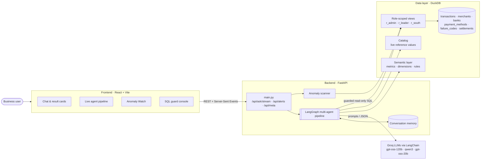
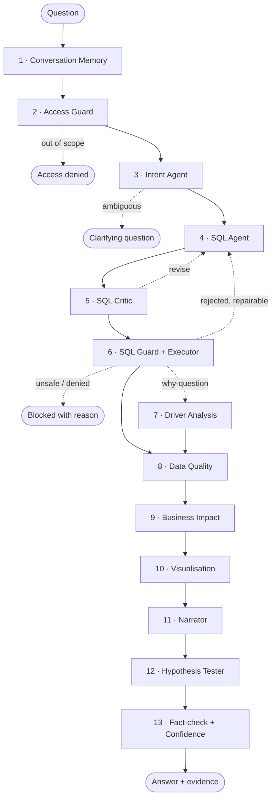
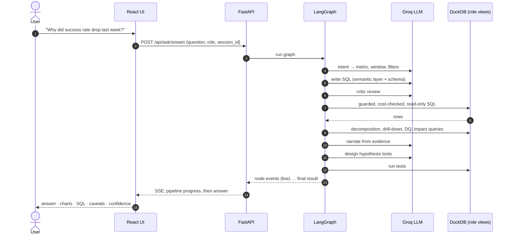
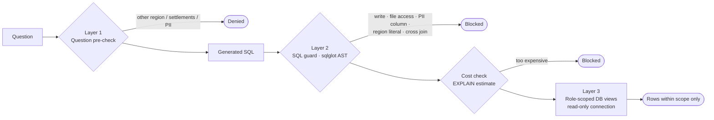
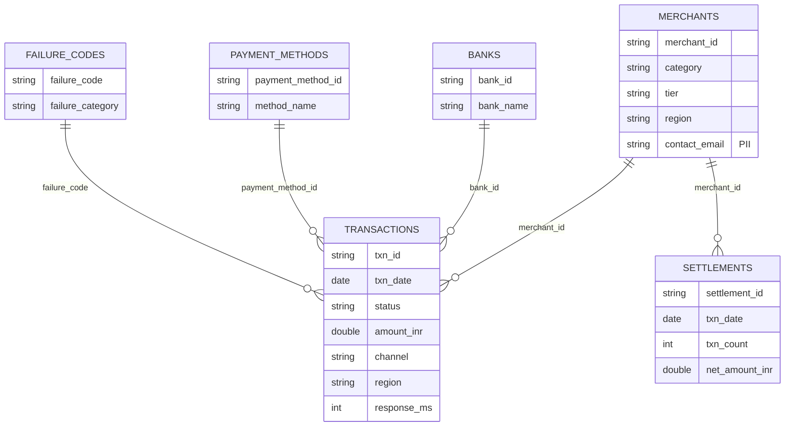

# PineSight — AI Business Analyst for Payments

> Ask a business question in plain English. Get a verified answer backed by executed SQL, segment drivers, charts, data-quality caveats and a confidence score — in seconds instead of hours.

PineSight is a **multi-agent NL-to-SQL analyst** for payments data. A leader asks *"Why did success rate drop last week?"*; PineSight finds the right datasets and measures, writes and validates SQL, runs it under the user's access scope, decomposes the change into its drivers, sizes the business impact, tests its own hypotheses, and returns an answer that clearly separates **facts**, **hypotheses** and **recommendations** — every number traceable to a query.

Built for the *Enterprise AI Business Analyst* challenge (Pine Labs Early Talent Program).

---

## Table of contents
1. [Key features](#key-features)
2. [System architecture](#system-architecture)
3. [The NL-to-SQL pipeline](#the-nl-to-sql-pipeline)
4. [Safety and access control](#safety-and-access-control)
5. [Analysis engine](#analysis-engine)
6. [Project structure](#project-structure)
7. [Getting started](#getting-started)
8. [API reference](#api-reference)
9. [Data model](#data-model)
10. [Evaluation](#evaluation)
11. [Demo script](#demo-script)
12. [Challenge coverage](#challenge-coverage)
13. [Assumptions and limitations](#assumptions-and-limitations)

---

## Key features

| | Feature | What it does |
|---|---|---|
| 💬 | **Natural-language questions** | Metrics, trends, breakdowns, comparisons and "why" questions in plain English |
| 🧠 | **Conversation memory** | Follow-ups like *"what about netbanking?"* or *"break that down by channel"* reuse the previous context |
| ❓ | **Ambiguity handling** | Asks a clarifying question when the metric or time period is missing; states the denominator as an explicit assumption |
| 🧾 | **Text-to-SQL with self-review** | LLM writes SQL from a semantic layer; a **SQL Critic** agent checks its meaning before it runs; failures loop back for repair |
| 🛡️ | **SQL guard** | AST-level validation: read-only, table/column allow-lists, PII and region scope, blocked file/system functions, cross-join block, row cap |
| 🔐 | **Role-based access** | Three roles enforced in three layers (question → SQL → database views) |
| 💸 | **Cost controls** | EXPLAIN-based cost limit, query timeout, result cap and an LRU query cache |
| 📉 | **Driver analysis** | Exact **rate-vs-mix decomposition** separates "a segment got worse" from "traffic moved to a weaker segment" (Simpson's paradox), with a significance test and drill-down |
| 💰 | **Business impact** | Converts a rate drop into extra failed payments and **₹ GMV at risk**, with a monthly run-rate and recovery scenarios |
| 🔬 | **Hypothesis tester** | Designs a falsifiable SQL test (with a control group) for each hypothesis, runs it, and labels it ✅ supported / ❌ refuted / ❓ inconclusive |
| 🧹 | **Data-quality checks** | Duplicates, missing values, ingestion gaps, coverage, and reconciliation between transactions and settlements |
| 🚨 | **Anomaly Watch** | Proactively scans every segment against its own baseline and surfaces incidents *before anyone asks*, with one-click "Explain this" |
| 📊 | **Charts and tables** | Trend, driver, drill-down and before-vs-after charts (Plotly), plus result tables |
| 📎 | **Citations** | Every answer cites datasets, filters, time window and the exact SQL |
| ✅ | **Fact-check and confidence** | Every number in a stated fact must match the evidence (unit-aware: lakh vs crore); a 0–100 confidence score with reasons |
| 🔎 | **Full transparency** | Live agent pipeline, agent trace with timings, token usage, all queries |
| 🧪 | **Known-answer evaluation** | 27-case evaluation harness and 19 unit tests |
| 🔌 | **Works offline** | Every LLM agent has a deterministic fallback, so the demo never breaks |

---

## System architecture



**Design principle — the LLM handles language, code handles correctness.** The LLM understands the question, writes SQL and writes the narrative. Everything that must be right — access control, SQL safety, statistics, data quality, impact sizing, fact-checking, confidence — is deterministic code. This keeps answers auditable and costs only ~4 LLM calls for a plain question and ~6 for a "why" question.

**Nothing is hard-coded to the data.** Banks, regions, payment methods, categories, channels and the data's date coverage are read from the database at runtime (`core/catalog.py`), so new values need no code change.

---

## The NL-to-SQL pipeline

The agents are nodes of a **LangGraph `StateGraph`** (`backend/core/orchestrator.py`). LLM agents are **LangChain** chains (`ChatPromptTemplate | ChatGroq` in JSON mode) whose output is validated with Pydantic.



| # | Agent | Type | Responsibility |
|---|---|---|---|
| 1 | **Conversation Memory** | rules + LLM | Rewrites follow-ups into a standalone question using the session's last turns |
| 2 | **Access Guard** | code | Refuses questions outside the role's scope (other regions, settlements, PII) — checked on the rewritten question so follow-ups can't bypass it |
| 3 | **Intent Agent** | rules + LLM | Extracts intent, metric, time windows, filters and grouping; routes payouts/fees to settlements; asks for clarification when needed |
| 4 | **SQL Agent** | LLM | Text-to-SQL grounded on the semantic layer, the role's visible schema and live valid values; receives critic/guard feedback on retries |
| 5 | **SQL Critic** | rules + LLM | Verifies *meaning* before execution: exact window, every filter, correct denominator, grouping matches the task |
| 6 | **SQL Guard + Executor** | code | AST safety checks, role views, EXPLAIN cost limit, timeout, row cap, cache |
| 7 | **Driver Analysis** | code | Rate-vs-mix decomposition across 6 dimensions, significance test, drill-down, failure reasons |
| 8 | **Data Quality** | code | Duplicates, NULLs, ingestion gaps, coverage, cross-source reconciliation |
| 9 | **Business Impact** | code | Extra failed payments → ₹ GMV at risk, run-rate, recovery scenarios |
| 10 | **Visualisation** | code | Picks chart types; driver and segment comparison charts |
| 11 | **Narrator** | LLM | Writes facts / hypotheses / recommendations from pre-computed evidence only |
| 12 | **Hypothesis Tester** | LLM + code | Designs and runs a falsifiable SQL test per hypothesis, then judges the result |
| 13 | **Fact-check + Confidence** | code | Every stated number must match evidence; computes a 0–100 confidence score |

### How a question flows



### Groq model pool
Each Groq free-tier model has its own quota (~8k tokens/min, ~200k tokens/day). `core/llm.py` spreads load across a pool (`gpt-oss-120b → qwen3.8-27b → gpt-oss-20b`), waits out short per-minute limits, benches a model whose daily quota is exhausted, and falls back to deterministic templates if every model is out. The UI shows `llm` vs `template` badges on each answer.

---

## Safety and access control



| Role | Access |
|---|---|
| **Data Admin** | All tables and columns, including merchant contact details (PII) |
| **Business Leader (National)** | All regions and settlements; no PII |
| **Regional Analyst (South)** | South-region transactions and merchants only; no settlements, no PII |

Even if a guard rule were bypassed, the database views still return only rows and columns the role may see (defence in depth). Runtime controls: 10 s timeout, EXPLAIN cardinality limit, 5,000-row cap, external file access disabled, LRU cache.

---

## Analysis engine

**Rate-vs-mix decomposition.** For each segment *s* with traffic share *w* and success rate *r* (before *a*, after *b*), the overall change splits exactly into:

- **Rate effect** = *w_b · (r_b − r_a)* — the segment itself got better or worse
- **Mix effect** = *(w_b − w_a) · (r_a − R_a)* — traffic moved toward a segment converting above/below average

If most of the change is mix, the decline is classified as a **mix shift** rather than a performance problem. The engine then drills into the worst segment (e.g. payment method → issuer bank), lists failure reasons, and runs a two-proportion z-test.

**Anomaly Watch** scans daily success rate for every segment (bank, method, channel, region, category, bank × method) against its own trailing 28-day baseline (binomial z-test), plus traffic-mix shifts and volume collapses. Overlapping alerts are clustered so the most specific one leads.

**Confidence score** combines statistical significance, data-quality issues, critic concerns, hypothesis-test results and fact-check outcomes, and every deduction is explained in the UI.

---

## Project structure

```
pinelabs/
├── backend/
│   ├── main.py                 FastAPI app: REST + SSE endpoints, serves the React build
│   ├── serialize.py            JSON serialisation of results, tables and Plotly figures
│   ├── config.py               Settings (reads ../.env); data coverage read from the DB
│   ├── core/
│   │   ├── orchestrator.py     LangGraph StateGraph, routing, fact-check, confidence, citations
│   │   ├── agents.py           Intent, SQL and Narrator agents + deterministic fallbacks
│   │   ├── critic.py           SQL Critic (rule checks + LLM review)
│   │   ├── memory.py           Conversation memory and follow-up resolver
│   │   ├── hypotheses.py       Hypothesis Tester
│   │   ├── impact.py           Business Impact sizing
│   │   ├── analysis.py         Rate/mix decomposition, significance, drill-down
│   │   ├── anomaly.py          Anomaly Watch scanner
│   │   ├── dq.py               Data-quality and reconciliation checks
│   │   ├── sql_guard.py        sqlglot AST validator
│   │   ├── executor.py         Read-only DuckDB execution, cost limit, timeout, cache
│   │   ├── rbac.py             Roles, question pre-check, role-scoped views
│   │   ├── semantic.py         Semantic layer: tables, metrics, dimensions, rules
│   │   ├── catalog.py          Live reference values read from the database
│   │   ├── timeparse.py        Time-window parsing ("last week", "week of Oct 12" …)
│   │   ├── charts.py           Plotly chart builders
│   │   └── llm.py              LangChain ChatGroq wrapper, model pool, quota handling
│   ├── data/
│   │   └── generate_data.py    Builds data/payments.duckdb with planted scenarios
│   ├── eval/
│   │   ├── questions.json      27 known-answer test cases
│   │   └── run_eval.py         Evaluation harness → eval/results.md
│   └── tests/                  Unit tests (guard, RBAC, critic, memory, fact-check, anomaly)
├── frontend/
│   ├── index.html
│   ├── package.json
│   ├── vite.config.js          Dev proxy /api → :8000
│   └── src/
│       ├── App.jsx             Layout, role switcher, streaming, conversation
│       ├── api.js              API client (SSE streaming)
│       ├── styles.css          Pine green theme
│       └── components/         Pipeline, ResultCard, AnomalyWatch, Chart, DataTable, SqlConsole
├── .env                        Your secrets (not committed)
├── .env.example                Template for .env
├── .gitignore
├── requirements.txt
└── README.md
```

---

## Getting started

**Prerequisites:** Python 3.11+, Node.js 18+, and optionally a free [Groq API key](https://console.groq.com) (the app runs without one using deterministic fallbacks).

```bash
# 1. Python environment
python3 -m venv .venv && source .venv/bin/activate
pip install -r requirements.txt

# 2. Configuration
cp .env.example .env               # then add GROQ_API_KEY

# 3. Generate the dataset (~550k rows, a few seconds)
python backend/data/generate_data.py

# 4. Build the frontend
cd frontend && npm install && npm run build && cd ..

# 5. Run — FastAPI serves both the API and the UI
cd backend && uvicorn main:app --port 8000
```

Open **http://localhost:8000**. Interactive API docs are at **/docs**.

**Development with hot reload** (two terminals):
```bash
cd backend && uvicorn main:app --reload --port 8000
```
```bash
cd frontend && npm run dev          # http://localhost:5173, proxies /api to :8000
```

### Configuration (`.env`)
| Variable | Default | Purpose |
|---|---|---|
| `GROQ_API_KEY` | — | Enables the LLM agents (optional) |
| `LLM_MODEL_STRONG` | `openai/gpt-oss-120b` | SQL, narrative, hypothesis design |
| `LLM_MODEL_FAST` | `openai/gpt-oss-20b` | Intent, critic, memory, judging |
| `LLM_MODEL_BACKUP` | `qwen/qwen3.8-27b` | Extra quota when others are rate-limited |
| `ANCHOR_DATE` | today | What "today" means for "last week" etc.; set it for reproducible demos |
| `QUERY_TIMEOUT_S` | `10` | Query timeout |
| `MAX_RESULT_ROWS` | `5000` | Result row cap |

---

## API reference

| Method | Path | Purpose |
|---|---|---|
| GET | `/api/health` | Database and LLM status |
| GET | `/api/meta` | Roles, demo questions, models, data coverage, agent graph |
| POST | `/api/ask` | `{question, role, session_id?}` → full analysis |
| POST | `/api/ask/stream` | Same, as Server-Sent Events: one `node` event per agent, then `result` |
| GET | `/api/alerts?role=` | Anomaly Watch alerts for a role |
| POST | `/api/session/reset` | `{session_id}` → clear conversation memory |
| POST | `/api/sql/validate` | `{sql, role}` → run raw SQL through the guard |
| POST | `/api/cache/clear` | Clear the query cache |

---

## Data model

Synthetic, fictional data in DuckDB (Aug 17 – Nov 15, 2026).



| Table | Rows | Notes |
|---|---|---|
| `transactions` | ~551k | Certified fact table (deduplicated) |
| raw transactions | ~554k | Raw feed incl. duplicates — read only by the data-quality agent |
| `merchants` | 300 | Category, tier, region, MDR, contact email (PII) |
| `banks` | 12 | Fictional issuers |
| `payment_methods` | 5 | UPI, cards, netbanking, wallet |
| `failure_codes` | 8 | TECHNICAL / BUSINESS / USER |
| `settlements` | ~22k | Separate system, T+1, deliberately disagrees in places |

### Planted scenarios (known answers)
| ID | Scenario | Window |
|---|---|---|
| S1 | Real decline: one bank's UPI timeouts spike | 2026-11-09 → 11-15 |
| S2 | Mix shift: netbanking share 12% → 30%, no method's own rate changes | 2026-10-12 → 10-18 |
| S3 | Duplicate records (replay bug) | 2026-10-05 → 10-07 |
| S4 | Missing `bank_id` | ~1%, rising to 3% in November |
| S5 | Ingestion gap: no East data | 2026-10-27 |
| S6 | Transactions vs settlements disagree; partly missing batch | throughout; 2026-11-10 |

The scenarios exist only in the data generator. The analyst has no knowledge of them — it must discover them from the data.

---

## Evaluation

```bash
cd backend
pytest -q tests                          # 19 unit tests
GROQ_API_KEY= python eval/run_eval.py    # offline run (no tokens used)
python eval/run_eval.py                  # with the LLM agents
```

The harness covers 27 cases — numeric known-answer queries, driver classification (rate vs mix), impact and hypothesis outcomes, access denials, clarifications, data-quality warnings, follow-ups and anomaly detection — and writes `eval/results.md`.

| Run | Result |
|---|---|
| Unit tests | 19 / 19 |
| Evaluation, offline | 27 / 27 |
| Evaluation, Groq LLMs | 27 / 27 |

> A full LLM evaluation uses most of a Groq model's free daily quota — prefer the offline run shortly before a demo.

---

## Demo script

1. **Anomaly Watch** has already flagged the incidents on load — click **Explain this** on the critical alert.
2. As **Business Leader**: *Why did success rate drop last week?* → rate-driven decline traced to one bank within UPI; show **Business impact**, **Hypothesis tests** and **Evidence & SQL**. Follow up with *what about netbanking?*
3. *Why did success rate fall in the week of Oct 12?* → classified as a **mix shift**, not a performance problem.
4. *How many successful transactions did we process in October, and do they match settlements?* → source disagreement and duplicate warnings.
5. *How did we do last month?* → asks which metric.
6. Switch to **Regional Analyst (South)**: *Show settlement payouts for all regions in October* → **access denied**; switch to Data Admin and click **Run again**.
7. **SQL guard console**: `DELETE FROM transactions` or a cross join → blocked.

---

## Challenge coverage

| Requirement | Implementation |
|---|---|
| ≥ 2 related datasets | 7 tables: transactions, merchants, banks, payment methods, failure codes, settlements (+ raw feed) |
| Natural-language questions | Memory → Intent → SQL agents |
| Generate and execute SQL | SQL Agent + Critic + Guard + Executor |
| Show query / analysis steps | Live pipeline, agent trace, Evidence & SQL tab |
| Charts or tables | Plotly charts + result tables |
| Cite dataset, filters, time window | Citations block on every answer |
| Facts vs hypotheses vs recommendations | Separate sections; hypotheses tested against data |
| Role-based access | 3 roles × 3 enforcement layers |
| Data-quality checks | Data Quality agent + warnings in every answer |
| Cohorts / drill-down | Segment decomposition and drill-down |
| Cost / timeout / caching | EXPLAIN limit, timeout, row cap, LRU cache |
| Known-answer evaluation | 27-case harness |
| Confidence & uncertainty | Score with reasons, significance test, fact-check |
| Missing / duplicate records | Raw-vs-certified duplicates, NULL keys, ingestion gaps |
| Out-of-scope access | Pre-check → guard → views |
| Two sources disagree | Transactions ↔ settlements reconciliation with source-of-truth policy |
| Mix-shift decline | Rate-vs-mix decomposition |
| Ambiguous period / denominator | Clarifying question; denominator stated as assumption |
| Expensive / unsafe query | AST guard, cost estimate, timeout, read-only |

---

## Assumptions and limitations

- **Mocked dependencies:** data is synthetic and fictional; sign-in is simulated by the role selector (RBAC itself is enforced in code and database views).
- **Conversation memory** is in-process and resets when the server restarts.
- **Denominator:** success rate excludes pending attempts by default (stated in every answer); a separate "all attempts" metric is available, but the agent does not ask about it.
- **Causality:** segment effects are descriptive; hypotheses are tested against the data, not against external incident logs.
- **Driver decomposition** applies to rate metrics; volume and GMV questions get segmentation without decomposition.
- **LLM quality and quota:** SQL quality depends on the Groq model; the critic, guard, repair loop and evaluation catch most but not all issues. Free-tier quotas can force template fallbacks.
- **Cost estimates** from DuckDB EXPLAIN are approximate; the timeout is the backstop.

### Future work
- Retrieval of verified question→SQL examples to improve SQL accuracy at larger schema sizes
- Real SSO and persistent conversation storage
- Linking hypotheses to external incident and bank-outage feeds
